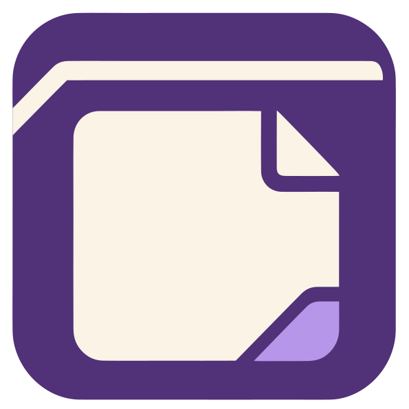
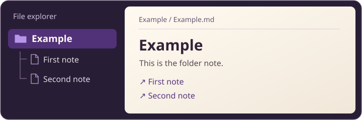

  

<h1 align="center">Folder Notes NG</h1>

Click a folder in Obsidian to open its note.

  <a href="#install">Install with BRAT</a> ·
  <a href="docs/docs/Getting%20started.md">Getting started</a> ·
  <a href="docs/docs/Folder%20overview.md">Folder overviews</a> ·
  <a href="https://github.com/cybersader/obsidian-folder-notes-ng/releases">Releases</a>

## How it works

A folder note is a note attached to a folder. Click the folder name to open the note. You can keep the note itself hidden from the file tree, and add a [folder overview](docs/docs/Folder%20overview.md) to list what’s inside.

## What NG changes

NG builds on [Lost Paul’s Folder Notes](https://github.com/LostPaul/obsidian-folder-notes). It changes how the plugin handles new files and folders, especially when another device is syncing them into your vault.

| If you want to… | Use… |
| --- | --- |
| **Leave time for a note to arrive over sync** | **Settings → Folder notes → General → Sync safety.** NG can wait, watch for an incoming note, and check the vault again before creating an empty one. |
| **Keep a loose note as a plain file** | Add `fn-ignore: true` to its frontmatter to skip automatic wrapping. You can also exclude a whole folder path. |
| **Wrap loose files without losing their names** | Enable automatic folder creation for files. The new folder takes the note’s name instead of being named `Untitled`. |

## Install

> **Already using Folder Notes?** NG uses the same `folder-notes` plugin ID as the [community store version](https://obsidian.md/plugins?id=folder-notes). Installing NG replaces that version; the two do not run side by side. Use BRAT for NG updates.

1. Install and enable [BRAT](https://obsidian.md/plugins?id=obsidian42-brat).
2. In BRAT, choose **Add beta plugin** and enter `cybersader/obsidian-folder-notes-ng`.
3. Enable **Folder notes** under **Settings → Community plugins**.
4. To try it without turning on automation, right-click a test folder (long-press on mobile), choose **Create folder note**, then click the folder name to open it.

## Build and test

Initialize the matching Folder Overview source with `git submodule update --init --recursive`, then run `npm ci` with Node 22. Unit tests also require Bun. The [CI workflow](.github/workflows/ci.yml) uses a synthetic vault and does not publish releases or upload vaults or screenshots.

| Check | Command |
| --- | --- |
| Official Obsidian lint, with no warnings allowed | `npm run lint` |
| Type-check and bundle the plugin | `npm run build` |
| Unit tests | `npm run test:unit` |
| Real Obsidian end-to-end tests on headless Linux | `xvfb-run -a npm run e2e` |
| Check files intended for the public repository | `npm run check:privacy` |

Use synthetic notes for contributions. Review screenshots and prose before pushing: a passing file or secret scan cannot tell whether they describe a real person.

## Credits and license

Lost Paul created [Folder Notes](https://github.com/LostPaul/obsidian-folder-notes) and [Folder Overview](https://github.com/LostPaul/obsidian-folder-overview). NG is an independently maintained, modified distribution. It added sync-safe creation in June 2026 and corrected binary-template writes and rename handling in November 2026.

NG retains the [GNU Affero General Public License, version 3](LICENSE) supplied with both upstream projects. The upstream Folder Notes package metadata says `GPL-3.0-or-later`, which differs from its license file; NG follows the supplied text and does not claim a separate grant from upstream. See [NOTICE](NOTICE) for third-party attribution. To get the build source for a release, check out its version tag and initialize its pinned submodule as described above.

[Support the original developer](https://ko-fi.com/D1D1GHGSI) · [Upstream documentation](https://lostpaul.github.io/obsidian-folder-notes/) · [Community Discord](https://discord.gg/4UQEDfQmuH)
